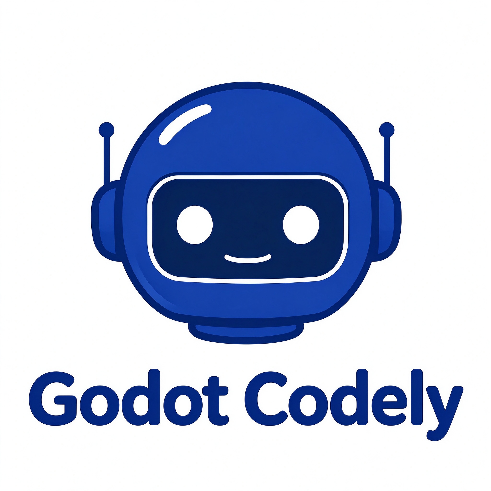

<h1 align="center">
  
  Godot Codely
</h1>

<p align="center">
  Godot 制作を補助する、<a href="https://github.com/dataelement/dsh-desktop">DSH Desktop</a> の公開 MIT fork。基盤は
  <a href="https://github.com/deepseek-ai/deepseek-harness">DeepSeek Harness</a>。
</p>

<p align="center">
  <a href="README.md">English</a> · <a href="README.zh.md">简体中文</a> · <a href="README.ja.md">日本語</a> · <a href="README.ru.md">Русский</a> · <a href="README.es.md">Español</a> · <a href="README.pt.md">Português</a>
</p>

<p align="center">
  <a href="LICENSE"></a>
  
  
</p>

## このリポジトリ

Godot Codely は `godot-codely` コマンドで Godot プロジェクトを変更します。コマンドは `godot-codely-lite` プリセット、Godot スキル、Godot MCP を使います。`.tscn` と `.gd` はテキストとして編集するため、Godot エディタを開いたままにする必要はありません。`project.run`、`project.export`、`editor.launch` には `GODOT_PATH` が必要です。

下にあるデスクトップホストは DSH Desktop で、`@deepseek-ai/dsh@0.2.0-rc.2` に固定しています。この fork が公開するのはソースです。[上流サイト](https://www.dshdesktop.com/#download)と[上流の GitHub Releases](https://github.com/dataelement/dsh-desktop/releases) にある署名済み macOS ビルドと Windows NSIS インストーラーは、元の DSH Desktop です。そこにはこのリポジトリの Godot コマンド、プリセット、MCP は入っていません。

## ソースから実行

Node.js 22 以降。

```sh
git clone https://github.com/hhhh124hhhh/godot-codely-desktop.git
cd godot-codely-desktop
npm ci
node packages/dsh-godot-stack/cli/godot-codely.mjs --list-models
```

タスクには自分で追加したモデル設定を使います。コマンドの形は [Godot スタックの説明](packages/dsh-godot-stack/README.md) にあります。API キーをリポジトリ、Issue、ログに置かないでください。

```sh
node packages/dsh-godot-stack/cli/godot-codely.mjs "現在の Godot プロジェクトを要約する"
```

プロファイル名は `godot-codely` です。`DSH_HOME` が未設定なら、プロファイルと共有メモリは `~/.dsh` にあります。デスクトップウィンドウは別プロセスで、起動時に同じ Godot プリセットを配置します。

```sh
npm run dev
```

セットアップ、確認、パッケージングは[開発ガイド](docs/development.md)。実行時の境界は[アーキテクチャ](docs/architecture.md)。

## 一緒についてくるホストの動作

- PPT モードは編集可能な PPTX を出力します。macOS と Windows では、オフラインの DOCX、PPTX、XLSX スキルに Python ライブラリが同梱されます。[PPT ランタイム](packages/ppt-runtime/README.md)。
- ペアリングしたスマートフォンでセッションを続けられます。遠隔経路は通常 Cloudflare Quick Tunnel です。Cloudflare が使えないときは Pinggy です。
- セーフモードはサードパーティープラグインを止め、ユーザーデータを残します。ウィンドウが開かないときは `--safe-mode` を付けます。この fork を macOS でパッケージしたあと: `open -a "Godot Codely" --args --safe-mode`。
- 持ち運べる Agent Preset は [`.dshpreset` パッケージ](docs/preset-packages.md) です。
- ホストは署名済み macOS DMG/ZIP、または署名済み Windows x64 NSIS インストーラーとしてパッケージできます。このリポジトリはそれらを公開していません。Linux と Windows ARM64 はホストの現在のサポート外です。将来の署名手順は[リリース手順](docs/release-runbook.md)。

## 上流のコミュニティ

下の WeChat グループと Discord は上流の DSH Desktop のものです。

<p align="center">
  <br />
  <a href="https://discord.gg/7Xgf3qe3Qp">上流 DSH Desktop Discord</a>
</p>

## 開発に参加する

- [貢献ガイド](CONTRIBUTING.md)
- [開発ガイド](docs/development.md)
- [アーキテクチャ](docs/architecture.md)

変更前に `npm test`、`npm run typecheck`、`npm run build` を実行し、触った操作を実際に確認してください。

## ライセンス

Godot Codely は [MIT License](LICENSE) です。ファイル内の著作権表示は、上流デスクトップの作者である DataElement のままです。DeepSeek Harness と同梱の Godot MCP は、それぞれのライセンスに従います。
